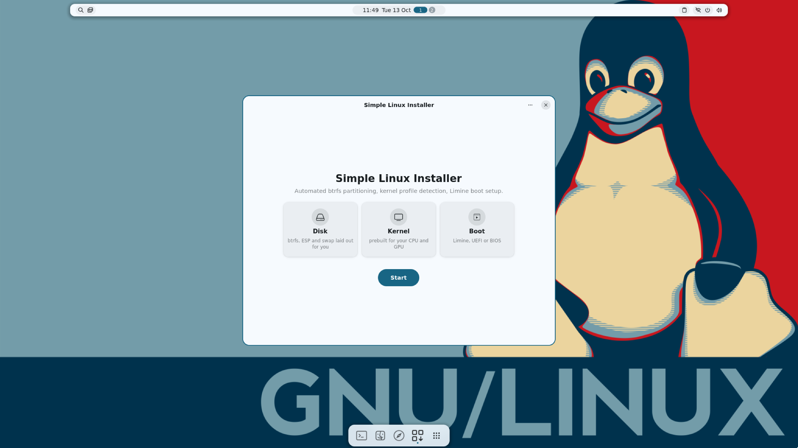

# Changelog

What changed in each Simple Linux release, newest first. The images, the installer and the configuration are versioned together;
the installer's own code history is in [gentoo-installer](https://github.com/tarilka0gg/gentoo-installer).
Downloads and checksums are on the [Releases](https://github.com/tarilka0gg/simple-linux/releases) page.

## 0.2.33

More software to choose from in the installer, nothing else changes in the live system. Sizes (0.2.32 → 0.2.33): GUI 514 → 517 MiB, minimal 362 → 363 MiB, GUI offline 1704 → 1706 MiB, minimal offline 1552 → 1553 MiB. Checked in QEMU, not on real hardware: the GUI image booted and its Software page lists the new groups; the packages below were installed in a Gentoo chroot and started in the live GUI session. An install of the new groups with the installer itself was not run.

- **Four new software groups** on the Software page: **Steam**, **Minecraft** (PineconeMC, the Prism Launcher fork with Ely.by accounts), **Creative Craft apps** (PhotoCraft, LightCraft, VectorCraft, DesignCraft, FilmCraft, EffectCraft) and **Craft office apps** (WordCraft, GridCraft, DeckCraft, PdfCraft). The Craft apps are the open-source programs of the ArtCraft project (Apache-2.0 or MIT): early versions, and they run on the CPU where there is no usable graphics card.
- **Their own overlay.** Portage has none of these programs (except Steam, which is in the `steam-overlay`), so the installer carries a small overlay, `slp-local`, with ebuilds that install the ready-made releases from GitHub, pinned by checksum; Steam's overlay is cloned from git. Ticking Steam is the acceptance of Valve's licence.
- **Steam rebuilds some packages for 32-bit** (util-linux, fontconfig, expat, Mesa...), so the installer runs `emerge --changed-use` when a group asks for 32-bit libraries. The dependency plan resolves (about 310 packages on a minimal system); **Steam itself was not installed or started.**
- **Screenshots** for Telegram, GIMP, mpv, VLC, LibreOffice, PineconeMC and the ten Craft apps on the Software page (27 in all).
- These groups are not on the offline images (they download); the binhost build leaves them out.

## 0.2.32

Sizes (0.2.31 → 0.2.32): GUI 513 → 514 MiB, minimal 361 → 362 MiB, GUI offline 1703 → 1704 MiB, minimal offline 1551 → 1552 MiB. Checked in QEMU, not on real hardware: the finished GUI ISO booted headless, SSH was tried against it (below), and its installer's Software page was opened in the live session and looked at. Headless installs of the minimal flavor and on legacy BIOS ran to the end; a UEFI install and a GUI-flavor install were not repeated with these final images.

- **Flavors and mix-ins, like Funtoo's `epro`.** A system is one flavor (`minimal`, `desktop`, `workstation`, and `live` for this image) plus mix-ins (16 software groups, 6 graphics cards). The data lives in `profiles/` of gentoo-installer and is compiled into the installer; the new `slp` command (`show`, `list`, `info`, `init`, `flavor`, `mix-in`, `apply`, `rebuild`, `install`) changes it on an installed system and writes the Portage files that go with it (`package.use`, `package.accept_keywords`, `package.license`, the set `@slp`). Both installers have a flavor choice; headless installs read `GENTOO_INSTALLER_FLAVOR`. The live image is built from the `live` flavor.
- **Software page with descriptions and screenshots.** One scrolling page: the flavor, then groups that expand to the packages in them, each with a description (all 70 packages) and, for 11 of them, a screenshot shipped inside the installer. Apps that are not in the live image have no screenshot.
- **Opt-in SSH in the live session.** `sshd` starts only when a key is found: an `authorized_keys` file on a volume labelled `SIMPLE_SSH`, or `ssh/authorized_keys` on the live medium. Keys only: password and keyboard-interactive logins are off. Checked: with the key disk the right key logs in, a password and another key are refused; without it nothing listens on port 22. Not found why the same test never answered in the virtual-GPU (GL) VM; the headless one works.
- **Fixed: the kernel build ran on every online install** in 0.2.27–0.2.31, not only when it was asked for. It now runs only when chosen (`GENTOO_INSTALLER_KERNEL_BUILD=1` or the page's option).
- **Fixed: installs on legacy BIOS (GPT disks)** failed for lack of a BIOS boot partition; the installer now makes a 1 MiB one at the end of the disk. Not covered: BIOS together with the "next to what is there" free-space placement, which makes no BIOS boot partition.
- Known noise: the live console prints "user.tester failed to start"; AMD graphics without LLVM is still untested.

## 0.2.31

Smaller again; the installer, the offline payload, the stage3, the kernel files and the Zen profile are those of 0.2.30. Sizes (0.2.30 → 0.2.31): GUI 560 → 513 MiB, minimal 369 → 361 MiB, GUI offline 1750 → 1703 MiB, minimal offline 1558 → 1551 MiB. Checked in QEMU, not on real hardware: the minimal image booted with the tools below; a test image built from the same GUI tree was run on the virtual GPU (niri and Noctalia up, a wallpaper set, a terminal opened, the installer window shown). The finished GUI ISO itself was not booted.

- **No LLVM in the GUI image.** Mesa is built without it (`USE=-llvm`): the AMD driver (radeonsi) compiles with its own compiler (ACO), and software OpenGL is `softpipe` instead of `llvmpipe`; the 107 MiB `libLLVM` is gone (27 MiB compressed), together with the SPIR-V helpers and clang. A machine with no usable graphics card still gets the graphical installer in its fallback window. **Not tested on an AMD graphics card, only on the virtual GPU.**
- **Portage's saved build environments** (`environment.bz2`, 12 MiB, already compressed) are left out: only `emerge -C` reads them.
- **Noctalia's default wallpaper** (a 5 MiB PNG) is left out; the live image sets its own wallpaper at every start.
- `iso/slim-excludes.py` refuses to build if a program that stays still needs a library it would drop, so a Mesa that still wanted LLVM cannot ship by accident.

## 0.2.30

Zen Browser in the live session comes ready; nothing else changes (the installer, the offline payload, the stage3, the kernel files and the image sizes are those of 0.2.29: GUI 560 MiB, minimal 369 MiB, GUI offline 1750 MiB, minimal offline 1558 MiB). The GUI tree these images are made from was started in QEMU and Zen was opened in it with the profile below (the finished GUI ISO itself was not booted); the minimal image was booted and runs as before.

- **Zen Browser in the live session starts from a fresh, ready profile every time**: DuckDuckGo as the search engine; uBlock Origin, SponsorBlock, CanvasBlocker and LocalCDN installed from addons.mozilla.org; DNS over HTTPS (Quad9), HTTPS-only mode and tracking protection; settings that spend less RAM and CPU (no site isolation, two content processes, no disk cache, a 64 MB memory cache); and the author's Zen layout, tabs on the right and no compact mode, with the nine Zen mods Zen downloads itself from its mod store at the first start (Quietify, Left close button, No Top Sites, Floating Status Bar, Better CtrlTab Panel, Tidy Popup, Cleaned URL bar, NoHighlightSplit, Add new tab urlbar icon). Checked with the real Zen 1.23.3b in an isolated profile: the extensions install and run, the preferences and policies apply, the mods are downloaded and their style sheet is built, the profile is left alone while Zen runs and made new when it starts again. The welcome pages the extensions open on their first install are closed again, Zen's "What's new" notice is switched off, and the extension buttons sit in the extensions panel, not on the toolbar. Not checked inside a live image, nor how the layout sits with the live session's window rules (the niri rule keeps Zen maximized).

## 0.2.29

Smaller images again. Only what the live system carries changes; the installer, the offline payload, the stage3 and the kernel files are the ones of 0.2.28. Checked in QEMU, not on real hardware: the minimal image boots and runs git, tcpdump and the installer without the removed tools; the GUI image boots to the niri desktop (Noctalia bar and dock, a terminal, the installer window) on software rendering.

- **Sizes** (0.2.28 → 0.2.29): GUI 592 → 560 MiB, minimal 387 → 369 MiB, GUI offline 1782 → 1750 MiB, minimal offline 1576 → 1558 MiB.
- **LLVM built for the CPUs a PC uses only** (X86 and AMDGPU, not AArch64, RISC-V, WebAssembly and the other 17 targets): `libLLVM`, which Mesa's software renderer and radeonsi load, is 107 MiB instead of 154 MiB.
- **Parts of packages instead of whole packages:** `git` is built without Perl, Python and GnuPG, `tcpdump` without libsmi (its 17 MiB of MIB files).
- **No build or documentation tools on the medium:** Perl and every Perl script, autoconf, automake, libtool, bison, flex, m4, nasm, vala, sassc, the mail client, man-db, groff, texinfo, mandoc, lld and mesa_clc, plus fish's developer tools (`fish_indent`, `fish_key_reader`) and hwdata's MAC-vendor lists. `iso/slim-excludes.py` makes the list and refuses to build when a program that stays still needs a library it would drop (it found that ghostty needs glslang, so that stays).
- Not checked: an install from these images, the offline images booting (only their size), and Perl-dependent scripts beyond the ones used in the checks.

## 0.2.28

Smaller images and the right name. The installer is rebuilt for the name change; the offline payload, the stage3 and the kernel files are the ones of 0.2.27. Checked in QEMU, not on real hardware: the minimal image boots to the installer and the shell, the GUI image boots to the desktop.

- **The system calls itself Simple Linux.** `/etc/os-release` says `Simple Linux` on the live medium and on every installed system, so Noctalia's System panel, fastfetch and similar tools stop saying "Gentoo". `ID` stays `gentoo`, because tools that read it mean the package base.
- **About 45 MB less in each image** (GUI 637 → 592 MiB, minimal 434 → 387 MiB, the offline ones shrink the same way). The live system no longer carries what it never uses: the compiler and binutils (the installer builds the kernel inside the *installed* system, which has its own), the GRUB files (the boot loader is Limine), and firmware for hardware no PC with a screen has (SDIO and SoC Wi-Fi boards, server NICs and storage adapters, TV and capture cards, ISA/PCMCIA-era devices, serial adapters, ADSL modems). `os-prober`, Python for `equery`, and the Wi-Fi, GPU, Bluetooth and audio firmware stay.
- Not checked: an install from these images, and the GUI installer's pages after the size cuts.

## 0.2.27

A new installer in all four images (and the offline payload, the stage3 and the kernel files unchanged from 0.2.26). Everything below was checked in QEMU, not on real hardware; what was not checked is said in each item.

- **Install next to other systems.** The disk page can use the free space of a GPT disk instead of erasing it: you pick how many GiB to give, the existing EFI partition is mounted (never
  formatted), Windows and other distros found on it appear in the Limine menu, and the installer registers its own UEFI boot entry. GParted is offered for making room. Checked in a VM with
  a disk holding fake Windows/Ubuntu loaders: they stayed intact, the menu listed them, the new system booted. Not yet checked: the graphical flow end to end, booting the other systems.
- **Several keyboard layouts** with a switch key (Caps Lock by default), applied to the running desktop at once on the live medium and written into the installed niri; **time zone search** by city,
  capital or country, and the zone found from the connection in the background (not on offline images).
- **Graphics page:** cards listed by name (vendor, model, integrated or discrete), a choice of the card the desktop is drawn on, the driver list folded into one row (it no longer covers the Continue
  button). The Optimization page is one list of switches; the disk, confirm and Wi-Fi pages scroll.
- **Optional kernel for this computer** (Advanced, Optimization; off by default): when the store has no kernel for exactly the hardware, the installer builds one from the
  [kernel-matrix](https://github.com/tarilka0gg/kernel-matrix) on the new system and keeps the generic kernel if the build fails. Checked in a VM (built, booted); the clang fallback and the NVIDIA path are not.
- **Fixes:** a resumed install uses the layout the first run made; the installed system is called `simple-linux`, not `gentoo`; the installer says "Simple Linux" instead of "Gentoo"; `simple-linux-update` keeps other
  systems' entries in `limine.conf` and leaves a kernel built on the machine alone; block devices of 0 B are not listed as disks.

## 0.2.26

A fix for the desktop of all four images; nothing else changed (the installer, the kernels and the stage3 are the 0.2.25 ones).

- **The colours follow the wallpaper again after the first prompt.** The images carry the author's saved Noctalia config, and in it the `colors_changed` hook was commented out, so `hooks/colors.d/*.sh` never ran after a wallpaper
  change: tui-shim's palette (`~/.config/tui-shim/palette.md`), micro's colour scheme and the line icons kept the colours of the first start while Noctalia's own templates (ghostty, btop, niri) changed. `prepare-rootfs.sh` now registers
  `started` and `colors_changed` in the config whatever its source. Checked in a VM with the 0.2.25 image: after `noctalia msg wallpaper-random` with the hook line added, `palette.md` and micro's scheme were rewritten 0.4 s after the new
  ghostty theme (before, they kept the time of the first start). A micro that is already open keeps its colours until it is restarted.

## 0.2.25

Two new images, **`simple-linux-gui-offline.iso`** (1.8 GiB) and **`simple-linux-minimal-offline.iso`** (1.6 GiB), that install **without a network**. The other two images, the stage3 and the kernel files are as before
(the installer in all four understands the offline medium).

- **What is on an offline medium** (outside the squashfs, next to the stage3): the kernel store, the binary packages of both binary hosts (322 from Gentoo's, 64 from this project's, their indexes cut down to those files), the Portage tree
  snapshot, the desktop configuration, and the source archives of the two packages that have no binary. The installer serves that directory to itself on `127.0.0.1` and points the kernel store, both binary hosts, the tree, the configs and
  `GENTOO_MIRRORS` at it, so Portage, git and wget inside the new system work as always (`installer-core/src/offline.rs`, `iso/make-offline.sh`). The network step of the wizard is skipped. When the install is done the new system's
  `binrepos.conf` and `make.conf` are put back to the public addresses.
- **What it covers.** The default software groups with the niri desktop and a GPU driver that is open source (Intel, AMD, Xe, Nouveau, none). **Not on the medium:** the groups Zen browser, Dev, Media, Graphics, Chat, Office and Gaming (together ~700 MB:
  GitHub takes no file over 2 GiB), the proprietary NVIDIA driver (it is built from source against the kernel) and other desktops than niri. They are not offered when installing from an offline image; install them on the finished system, with a network.
- **`linux-firmware` is cut down** on the offline images: 609 MB become 127 MB by dropping what real hardware seldom has (phones' Qualcomm, NVIDIA's, server NICs, Intel QAT/ICE/VPU, a few Atheros chips). GPU (Intel, AMD, Radeon), Wi-Fi and Bluetooth (Intel, Realtek, MediaTek,
  Atheros, Broadcom), audio and common Ethernet are kept. The tree snapshot on the medium carries the Manifest line of the cut archive. `emerge -1 sys-kernel/linux-firmware` on a networked system brings back the complete set.
- **Checked in QEMU with the outside network blocked** (only the log port reachable): a headless install of the GUI offline image from partitioning to the bootloader (stage3, kernel, 322+64 packages, the desktop, ustan, Portage Store and tui-shim copied),
  and the installed system booted to a login. The minimal offline image boots, finds the payload and goes straight to the disk screen. **Not checked:** an install from the minimal offline image end to end, the graphical wizard on the offline image,
  real hardware, and the installed desktop on screen in a VM (no virtual GPU driver in the generic kernels, as before).

## 0.2.24

Checked in QEMU: the live session (terminal, launcher order and icons, micro with the picker badge, wallpaper colours) and a headless install of the GUI image on an NVMe disk (a generic kernel, packages from the binhost,
nothing compiled) that booted to a login; there the copied `tui-shim`, its micro shim, the launcher entries and the palette were all in place. **Not checked:** the installed desktop on screen: the generic kernels have no
virtual GPU driver (as in 0.2.22 and 0.2.23), so niri starts but a VM shows only the console; the graphical wizard end to end; the minimal image.

- **tui-shim is in the GUI image** (`/usr/bin/tui-shim`, built from its ebuild; `grim` comes with it). In a terminal, plain `micro` gets a round folder badge in the window's corner; clicking it
  (or F9) opens a file picker, and the chosen file opens in the same editor window. At the first prompt of every user fish sets it up once, in the background: `tui-shim shims install`
  and `tui-shim sync --no-theme` (launcher entries with icons for btop, micro, tmux, ...). The installer copies the binary to `/usr/local/bin` of the installed system when the desktop has libadwaita and gtk4-layer-shell.
- **Colours follow the wallpaper.** btop and yazi stay coloured by Noctalia (`tui-shim sync --no-theme`). micro, whose Noctalia template is a download that is not in the image, gets a scheme
  made from the same palette, and the file picker uses it too: `noctalia/hooks/colors.d/30-tui-shim.sh` rewrites `~/.config/tui-shim/palette.md` from Noctalia's ghostty theme at every palette change
  (a dark starting palette is in `apps/tui-shim`).
- **Launcher icons.** The entries tui-shim makes (micro, btop, tmux, "Edit in terminal", "TUI app versions") are line drawings in the style of the other icons. Theme icons were black squares in
  Noctalia's launcher, because it recolours a coloured, filled icon into one flat colour. The drawings are redrawn in the new palette when it changes (`TUI_SHIM_LINE_ICONS`).
- **Launcher order.** Noctalia lists apps by how often they were started and the rest alphabetically; a fresh image had no counts, so btop and "Edit in terminal" came first. The image now starts with counts
  that put the installer, Ghostty, Thunar, Zen, Portage Store, ustan and GParted first and the terminal programs after them (`usage_counts.json`); real use takes over from there.
- `~/.local/bin` comes first in fish's `PATH` in every terminal, so the shims win over `/usr/bin/micro`.
- **fastfetch:** a compact 13-row braille snake is used in terminals smaller than 100x32; the big one otherwise. The logo is no longer garbled when the terminal window is still being sized at start.
- `grim` is in the installer's *Desktop utilities* group.

## 0.2.23

Checked in QEMU (the live session, a terminal opened after closing the installer).

- **fastfetch.** The Simple Linux snake is the logo: braille dots (26 rows carry the detail of ~100 rows of letters, so the art stays smaller than the text next to it), with eyes
  and a red tongue. The OS line says `Simple Linux`, the title `user@simplelinux`. The modules are the author's own (OS, System Age, packages, WM, display, CPU, GPU, memory, `/` and `/home`, colours).
  The snake keeps the terminal's own white and light black and takes only 10 % of the wallpaper's accent colour (`simple-linux-configs`: `noctalia/hooks/colors.d/20-fastfetch.sh`;
  Noctalia's own fastfetch template, which recolours everything, is off).
- **fastfetch in every terminal of the live image.** It runs at the first prompt and is cleared when the first command is typed, as in the author's own fish (`/etc/fish/conf.d/10-house.fish`).

## 0.2.22

Built and tested in QEMU:

*The live session: the installer opens in the middle of the screen, in the colours of the wallpaper (Noctalia draws the wallpaper first, the installer starts after it).*

- **Binary install.** The installer adds [simple-linux-binhost](https://github.com/tarilka0gg/simple-linux-binhost) as a second binary host (signed, higher priority than Gentoo's),
  trusts its key the way `getuto` trusts Gentoo's, and unpacks the Portage tree snapshot the packages were built against instead of the day's tree. `make.conf` no longer sets this
  machine's `CPU_FLAGS_X86` or an unusual `VIDEO_CARDS` in binary mode (they made Gentoo's binaries mismatch and Portage compiled `mesa`, `pixman`, ...), and a `cpuid2cpuflags` bug
  that put the variable's name into the value is fixed. Packages are merged in parallel (`--jobs`). Optional groups state the USE they need (Qt `opengl`, `qml`, ...); `*/*::guru ~amd64`
  fixes the install that stopped on `mangohud`'s GURU dependencies; `DONT_MOUNT_BOOT` fixes `linux-firmware` aborting in the chroot.
- **The installer shows progress.** The Installing page lists every step (tick, spinner, cross, time taken), says what is happening now (a download in MB, "package 3 of 31"), has a bar
  with percent and elapsed time, and the log is open and follows the newest line; it now includes what the commands print.
- **`/` and `/home` on separate partitions.** After ESP and swap the system gets 20 % (40 % on a disk under 128 GiB, never under 20 GiB), `/home` the rest, so a full home cannot starve the system.
  On a disk with less than 40 GiB left after swap everything stays in root.
- **The wallpaper's colours reach the programs.** niri's ring and borders, ghostty, btop, GTK 3/4 (with `adw-gtk3`), Qt programs (`qt6ct`, KDE colour scheme), yazi, fuzzel, Neovim, Zen, Telegram (the theme file is written, choosing it is one click in Telegram), micro, tmux, fastfetch, GIMP; Noctalia starts after the wallpaper is chosen,
  so there is no flash of the wrong theme. The installed system gets the same, with the project's wallpapers and a random one at every start. (`simple-linux-configs`: `apps/`, `noctalia/hooks/`.)
- **Touchpads work.** The live kernel had only `I2C_HID_ACPI`: on a laptop whose touchpad hangs off the chipset's Serial IO I2C bus (the HP Victus' `SYNA32E3`, most
  laptops since about 2019) no input device appeared at all. It now has the Intel Serial IO (`MFD_INTEL_LPSS`, `I2C_DESIGNWARE`), GPIO (`PINCTRL` Intel and AMD), `HID_MULTITOUCH`, RMI4, Elan, THC/QuickI2C
  and sensor-hub drivers (+4.6 MiB image, all of them load in a VM; **the touchpad itself is not confirmed on real hardware yet**). The generic store kernels (x86-64 v2/v3) lacked them too and are rebuilt;
  the Raptor Lake builds already had them.
- **Ghostty takes the wallpaper's colours.** Its starting config also loads Noctalia's theme file as a `config-file`, which wins over colours set by hand, and the Noctalia start script
  creates the ghostty config if a system lacks one.
- **Enter works on the account page** (username, password, confirmation, Continue).
- **Secure Boot for the installed system** (off by default): a key made on the machine, Limine and its config signed and pinned; the certificate is put in `/boot/secureboot/` to enrol.
  **`simple-linux-update`** updates the kernel (the old one stays as a boot entry) and runs `emerge` for the system.
- **Live image.** The look no longer pins the author's palette, wallpaper folder or niri colours: everything is generated from the wallpaper.
  - The installer starts after Noctalia has drawn the wallpaper, so it comes up in the wallpaper's colours; it is titled "Simple Linux Installer".
  - The bar floats (Noctalia 5.2 names its margins `margin_edge`/`margin_ends`; the old `margin_h`/`margin_v` were silently ignored) and uses the capsule layout; the overview shows the blurred wallpaper.
  - Zen opens tiled and maximized, and its dock entry is the one that downloads the browser.
  - Portage Store is in the launcher. On its first start it downloads the Portage tree snapshot (88 MB) and builds its search index; its category tiles follow the wallpaper palette. App icons come from Flathub, so only apps that exist there get one.
  - The terminal prompt is [tide](https://github.com/IlanCosman/tide) in the palette's colours with a JetBrainsMono Nerd Font; the hostname is `simple-linux-live`.
  - On real hardware every monitor is set to its highest resolution and refresh rate at start (not in a VM).
  - One wallpaper (the penguin with stripes) is removed.
- **Smaller image:** build-only tools (cmake, cargo-c, ...), static libraries, development data, phone/router-only Wi-Fi firmware and a second copy of the CPU microcode are no longer in the live image (about 125 MiB).

Checked: headless installs in a VM (default groups and every group, 261 and 263 binary merges, nothing compiled), the installed system booting and starting niri on a virtual 3D GPU with
the terminal, Thunar, fastfetch and the panel in the wallpaper's colours. The GUI image is 636 MiB (0.2.21: 760), the minimal 434, the kernel store 248 (the generic builds are now configs for real hardware: NVMe/SATA built in, no virtio, so a VM disk must be NVMe or SATA).
**Nothing has to be configured.** The kernels are the assets of the `kernels` release of [simple-linux-binhost](https://github.com/tarilka0gg/simple-linux-binhost) (ten builds and a `Packages` index), the packages and the Portage tree snapshot are there too, and the configs come from simple-linux-configs: all defaults of the installer (`GENTOO_STORE_BINHOST_URL` and the others only override them). A headless install from the released GUI image on an NVMe disk with only the disk and the user set took the kernel and packages from GitHub, compiled nothing, and the installed system booted to a login. **Not checked:** the graphical wizard end to end with these changes (the headless run uses the same phases, not the same
screens), Secure Boot of the installed system under OVMF, any real hardware.

## 0.2.21

- **Launcher and dock.** The dock pins the Zen Browser entry that downloads the browser (not the empty `zen-zen-bin` one); Noctalia, Panel, About Xfce, the Thunar helpers and the console tools (btop, Micro) are hidden from the launcher. Application icons are glyph-style (symbolic) and Noctalia recolours them to the wallpaper palette; the full-colour icon sets only gave solid blobs when recoloured.
- **Colours follow the wallpaper everywhere:** the focus ring and window borders of niri come from the same palette (`noctalia.kdl`). The random wallpaper is requested until Noctalia has really applied one (it could be missed at start). The deprecated `middle_click_opens_widget_settings` line, which showed a notification, is gone.
- **Wallpapers:** 17 left (the Dragon Ball one and a 5120x1440 ultrawide are removed). Checked in QEMU only. The minimal image is unchanged.

## 0.2.20

- **A different wallpaper on every start, and the colours follow it.** The graphical session picks a random wallpaper from `~/Pictures/Wallpapers/simple` when it starts, and Noctalia generates the palette from it (Material You, `m3-tonal-spot`, light); GTK 3/4 apps and the installer use that palette. Replaces the fixed Gruvbox look of 0.2.19: the GTK theme is plain Adwaita, the niri borders are neutral.
- **The installer has a launcher entry** (`Install Simple Linux`, with an icon), so the dock and launcher no longer show the raw app id. Icons are WhiteSur. Checked in QEMU only: the random pick itself was seen to run, a change of palette between starts was not looked at on screen. The minimal image is unchanged.

## 0.2.19

- **Gruvbox in the graphical image.** Noctalia uses its built-in Gruvbox palette (light), which also recolours GTK 3/4 apps, the installer, the terminal and btop; niri's focus ring and borders use Gruvbox colours. The GTK theme is Gruvbox-Light.
- **WhiteSur icons.** The images only had Adwaita, so the installer and apps showed generic icons; the WhiteSur icon theme is now installed and set as the default (also through a GSettings default, since GTK 4 reads that before `settings.ini`). Application icons in the dock are no longer recoloured to one colour. Checked in QEMU (UEFI): the installer shows the Gruvbox colours and WhiteSur icons. The minimal image is unchanged.

## 0.2.18

- **Simple Linux wallpapers in the graphical image.** 19 wallpapers are in `~/Pictures/Wallpapers/simple` of the live session (`wallpapers/simple/` in this repo); the wallpaper picker (Ctrl+Alt+T) shows them in the `simple` folder. The minimal image is unchanged from 0.2.17.

## 0.2.17

- **ustan 0.2.2 is in both images** (it was a build from before 0.2.1): AppImages start without FUSE 2 and a launcher that dies right away shows its last output instead of failing silently.
- **Ventoy normal mode finds the image by itself.** If no device carries the label `GENTOO_LIVE` (a bootloader that Ventoy chain-loads, a kernel that only sees the USB stick), the initramfs now mounts the drives read-only, looks for an `.iso` with that volume label (up to three directories deep) and attaches it as a loop device, saying so on the console instead of waiting silently. Nothing changes when the label is already there (a real CD, Ventoy's grub2 mode). `rd.iso.autoscan=0` turns it off. Checked in QEMU on a real Ventoy 1.1.17 exFAT stick image and with Ventoy's own menu in UEFI; not yet confirmed on the laptop that showed the stall.

## 0.2.16

- **The installer inside the images is the current one.** The 0.2.14 and 0.2.15 images were built from an older build of the graphical installer, without the later changes (the software step in the normal flow, working search in the keyboard and timezone lists, uniform icon badges). Nothing else differs from 0.2.15. Checked in QEMU: both images boot from Ventoy (BIOS and UEFI, normal mode) and written straight to a stick (BIOS, UEFI, Secure Boot).

## 0.2.15

- **Ventoy works in BIOS without choosing a mode.** The BIOS stage of Limine in the images is rebuilt with a one-line patch (`iso/patches/limine-12.3.3-ventoy-bios.patch` in gentoo-installer; `iso/build-limine-bios.sh` makes it): Ventoy's virtual CD is a 2048-byte-sector drive that is neither flagged removable nor ATAPI, so stock Limine skipped it and stopped with "Could not determine boot drive". The BIOS config also no longer pins file hashes (only Secure Boot on UEFI needs them), which fixes the `Blake2b hash … does not match` panic that one tester saw when starting the image from Ventoy on BIOS. Checked in QEMU with Ventoy 1.1.17: BIOS and UEFI, normal mode and grub2 mode, for both images; and written straight to a stick on BIOS, UEFI and Secure Boot.
- **Zen Browser downloads in the background** as soon as the graphical session starts (no terminal window any more); opening it earlier just waits for the download.

## 0.2.14

- **portage-store is in the GUI image and in an installed desktop.** The installer copies it from the live system (programs under `/usr/local`, the helper in `/usr/libexec/portage-store/`). It adds one passwordless `doas` rule for the wheel group, limited to that helper: `permit nopass :wheel cmd /usr/libexec/portage-store/priv-helper`. `GENTOO_INSTALLER_STORE=0` skips the whole thing. The minimal image does not have it (no GTK).

## 0.2.13

- **The installed system matches the GUI image.** The default package groups now include everything the GUI live image has (file manager, audio, desktop utilities, disk tools, hardware tools, Gentoo tools). The browser group installs Zen, as the image does. Expect a much larger default install (about 186 packages, ~800 MB of downloads, some compiling); untick groups you do not want.
- **`btop` instead of `htop`, and `fastfetch`,** in both images and in the installed system.

## 0.2.12

- **root has fish as its login shell** on the installed system (and, when the desktop presets are installed, the same fish setup as the user). The account is still locked: this is the shell for `su`, `doas -s` or a rescue login. Checked in a VM: `/etc/passwd` of the installed system has `root:…:/usr/bin/fish`.

## 0.2.11

- **Your fish is installed with the system.** The installer copies the author's fish setup (the tide prompt with his settings, fisher, sponge, autopair, `config.fish`) into the new user's `~/.config/fish` when the system has fish. The configs live in [simple-linux-configs](https://github.com/tarilka0gg/simple-linux-configs) (the repository that used to be `gentoo-wm-configs`; the old address redirects). The live image uses it by default, so a desktop install no longer needs `GENTOO_WM_CONFIGS_URL` to be set by hand.
- tide draws its icons with a Nerd Font: use a terminal with one (the plain Linux console shows squares).

## 0.2.10

- **ustan is also installed on the system you install.** The installer copies it from the live image into `/usr/local` of the new system (the `ustan` command always; the window and its menu entry when a desktop was installed). Skip it with `GENTOO_INSTALLER_USTAN=0` in the headless mode. It is not part of Portage, so it is not updated with the system.

## 0.2.9

- **ustan is in the images.** [ustan](https://github.com/tarilka0gg/ustan) installs a .deb, an AppImage, a Flatpak bundle or a Windows .exe from a window (or `ustan install <file>`). The GUI image has `ustan-gui` with a menu entry, the minimal image the `ustan` command.

## 0.2.8

- **The graphical installer starts much sooner on machines without 3D** (old or unsupported GPUs, most VMs): ~9 s after the kernel starts instead of ~31 s (measured in QEMU). The live session used to wait a fixed 25 s for niri; it now checks for a 3D-capable GPU driver and goes straight to the software-rendered window when there is none. With a 3D GPU nothing changes except that it no longer waits.
- The boot menu waits 3 s instead of 5.

## 0.2.7

- **Smaller again** (minimal 652 → 514 MiB, gui 880 → 734 MiB): the root image no longer holds a second copy of the initramfs and the microcode images; Intel microcode for the newest server-only CPUs (Granite/Sierra/Emerald Rapids, Grand Ridge) is gone (Sapphire Rapids and everything older stays; such a CPU still boots on the firmware's microcode); Python keeps only what `equery` needs.

## 0.2.6

- **EROFS instead of squashfs for the root image** (LZMA, 1 MiB clusters): about 120 MiB smaller. The live kernel has EROFS built in (the kernel file in this release replaces the earlier one). Boot is about 2 s slower to reach the services, measured in a VM.
- **OpenRC starts services in parallel** (`rc_parallel`), which gives back about 1.5 s of that.

## 0.2.5

- **Smaller again** (minimal 851 → 747 MiB, gui 1227 → about 1000 MiB): Zen Browser and the NVIDIA GSP firmware are no longer on the medium.
- **Zen is downloaded on first use.** The GUI image has a "Zen Browser" entry (and `get-zen`) that fetches the current release from Zen's GitHub page (~110 MB, HTTPS, no checksum is published there) and runs it. Without that firmware the live GUI on RTX 20xx and newer cards runs in software (the cage fallback); the installed system is not affected.

## 0.2.4

- **The stage3 is downloaded, not shipped** (minimal 1091 → 851 MiB, gui 1467 → 1227 MiB). The images set `GENTOO_INSTALLER_STAGE3_URL` to the latest release's stage3 and the installer verifies it against the `.sha512` published next to it. A full install in a VM did this, and the installed system had fish, eza and micro, no nano. For use without a network you need your own image: `STAGE_TARBALL=… iso/assemble-iso.sh` (see the installer repository).

## 0.2.3

- **Smaller:** the Rust and Zig toolchains that were only needed to build the image are no longer in it (minimal 1202 → 1091 MiB, gui 1634 → 1467 MiB, even with the additions below).
- **More tools** (also in the GUI image), picked from the official Gentoo minimal CD's list: `gptfdisk` (gdisk/sgdisk), `iw` and `wpa_supplicant`, `nmap` (with ncat and nping) and `traceroute`, `eix` and `gentoolkit` (`equery`; Python is in the image for it), `screen`, and **Memtest86+** (two boot-menu entries, BIOS and UEFI; under Secure Boot the UEFI one is refused by the firmware since it is unsigned). The Portage tree is not on the medium, so `eix`/`equery` are only useful once you have one.

## 0.2.2

- **The installer now starts on older CPUs.** `installer-cli`/`installer-gui` were linked on a machine whose libc is built for x86-64-v3, so the binaries carried a "v3 needed" note and the live system refused to run them on anything older than Haswell (Westmere, Sandy/Ivy Bridge Xeons: "CPU ISA level is lower than required"). The images booted fine; only the installer did not start. Fixed, and checked in QEMU with Westmere, Sandy Bridge and a plain `qemu64` CPU, BIOS and UEFI, both images, 1 to 4 CPUs, 1 to 3 GB of RAM.

## 0.2.1

- The images carry a `boot/grub/grub.cfg`, which is what makes them bootable from Ventoy (see above).

## 0.2.0

- **One install path.** The text and graphical installers run the same phase pipeline as `--headless`, and a failed install can be **resumed** (`r` in the text installer, a button in the GUI, `--resume`): done steps are skipped, the rest continue. The VM test of this found that the base-system step could not run twice (it now remembers an unpacked stage and re-fetches the overlay); fixed.
- **Graphics.** Every graphics adapter is detected, `VIDEO_CARDS` covers all of them (hybrid laptops used to get only the discrete GPU's driver; the values are now Gentoo's: `amdgpu radeonsi`, `intel`, `nvidia`, `virgl` in a VM), and the compositor renders on the discrete GPU unless asked otherwise (`GENTOO_INSTALLER_RENDER=integrated`): niri's `render-drm-device`, `WLR_DRM_DEVICES`/`AQ_DRM_DEVICES` for the others, and Noctalia's shared GL context is switched off for the proprietary NVIDIA driver.
- **Language and time zone** follow the keyboard layout (a `ua` keyboard gives `uk_UA` + `en_US` and `Europe/Kyiv`); only unambiguous countries get a zone.
- **Kernels.** The installer picks from a real per-hardware store (`simple-linux-kernel-store.tar`); a full install from the minimal image used `generic-x86-64-v3-none-desktop` from it.
- **Images** are about 8 % smaller (squashfs zstd level 19, 1 MiB blocks); both were booted as a USB stick on BIOS, UEFI and Secure Boot. The GUI image without 3D falls back to a cage-hosted graphical installer, or the text one.
- **Signing**: signed checksums and Secure Boot as above. `GENTOO_INSTALLER_WM=none` installs no desktop.

## 0.1.2 (installer)

A full install through the text installer was run in a VM for the first time (network → disk → account → confirm, with the
desktop and the Wi-Fi group), rebooted, and the installed disk booted and logged in. That found and fixed: the text installer had
**no screen to create a user** (now it has one); it **hid errors** (a failed step left the screen frozen on the last line); it
read the wm-configs URL from the wrong variable; the **reboot button called `systemctl`** (this system is OpenRC; now `reboot`);
**no service was enabled on the installed system** (`dbus`, `seatd`, `iwd` now are, with the user in `seat`, `video`, `render`,
`input`, `audio`); **fish ignored the desktop autostart** and **`/run/user/<uid>` was never created**. Still unseen: a picture of the
installed desktop (the VM's virtual GPU has no driver in the installed Mesa) and any real hardware.
