# Simple Linux

[](LICENSE) [](https://github.com/tarilka0gg/simple-linux/releases) [](CHANGELOG.md)

A small Gentoo-based live system with its own installer. Two bootable images, the stage3 they
install from, the kernel, and the desktop setup the GUI image boots into.

**[Changelog](CHANGELOG.md)** · **[Releases](https://github.com/tarilka0gg/simple-linux/releases)** · **[Installer source](https://github.com/tarilka0gg/gentoo-installer)** · **[Binary packages](https://github.com/tarilka0gg/simple-linux-binhost)**

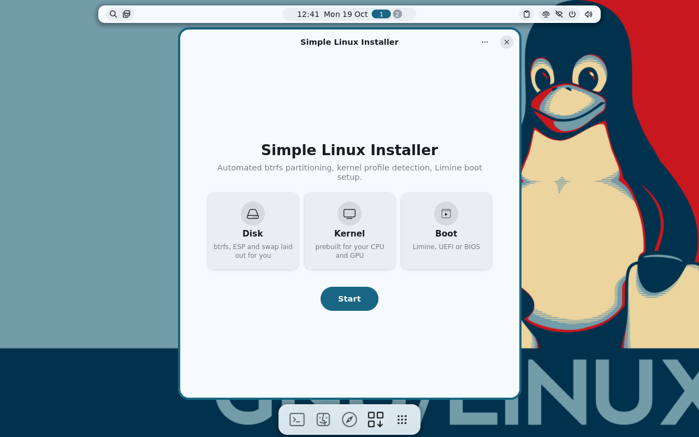

The installer and the scripts that build all of this live in
[gentoo-installer](https://github.com/tarilka0gg/gentoo-installer) (GPL-2.0-or-later). This repository
holds what comes out of that build, and the parts that are configuration rather than code.

## The live session

What the GUI image boots into (screenshots of 0.2.33, taken in a virtual machine).

<table>
  <tr>
    <td width="50%"><a href="docs/img/0.2.33/live-desktop.png">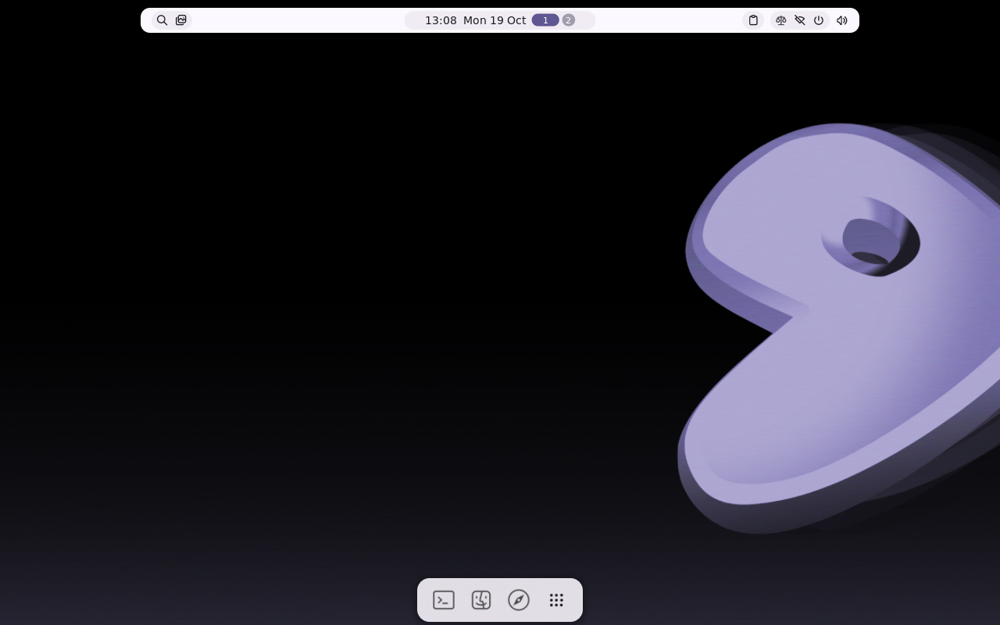</a></td>
    <td width="50%"><a href="docs/img/0.2.33/live-launcher.png">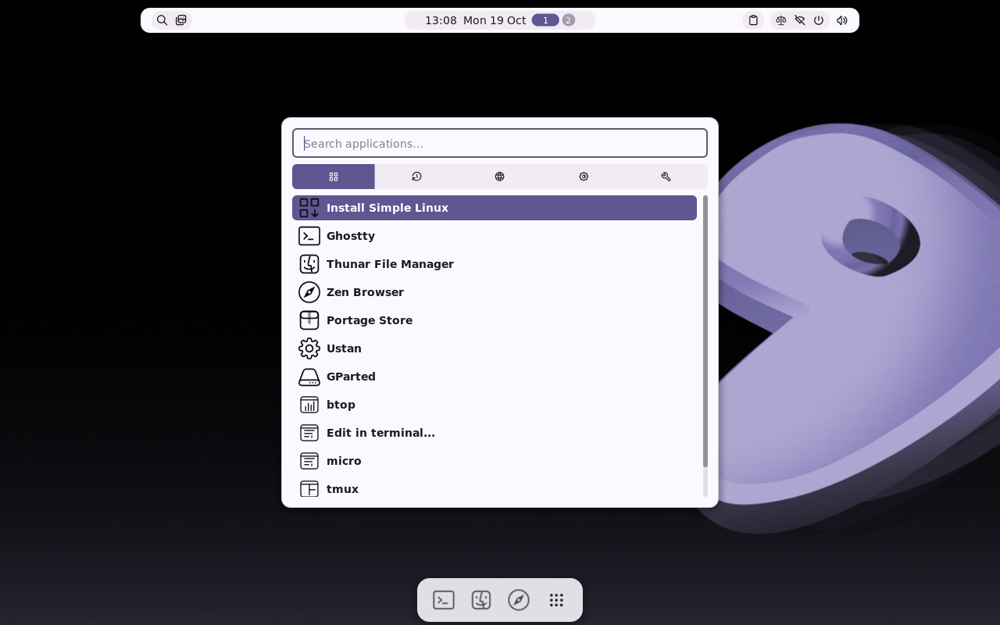</a></td>
  </tr>
  <tr>
    <td><b>The desktop</b><br><sub>niri with the Noctalia bar and dock, in the colours of the wallpaper.</sub></td>
    <td><b>Launcher</b><br><sub>Install Simple Linux, Ghostty, Thunar, Zen Browser, Portage Store and more.</sub></td>
  </tr>
  <tr>
    <td width="50%"><a href="docs/img/0.2.33/live-terminal.png">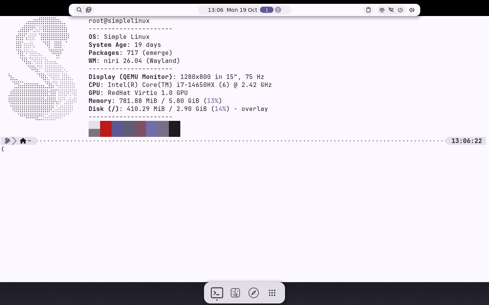</a></td>
    <td width="50%"><a href="docs/img/0.2.33/live-windows.png">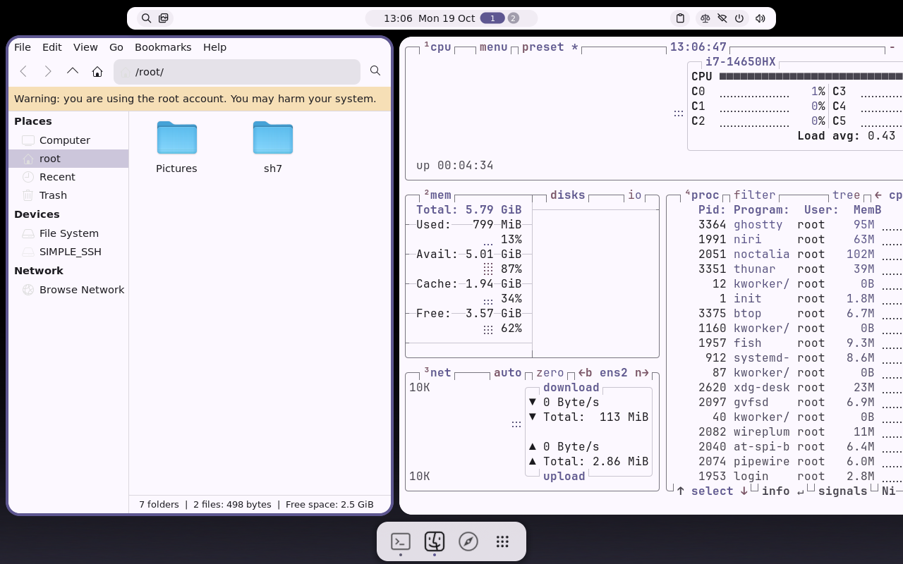</a></td>
  </tr>
  <tr>
    <td><b>Terminal</b><br><sub>Ghostty with fish and fastfetch.</sub></td>
    <td><b>Tiling</b><br><sub>Thunar and btop side by side in niri's scrolling columns.</sub></td>
  </tr>
  <tr>
    <td width="50%"><a href="docs/img/0.2.33/live-browser.png">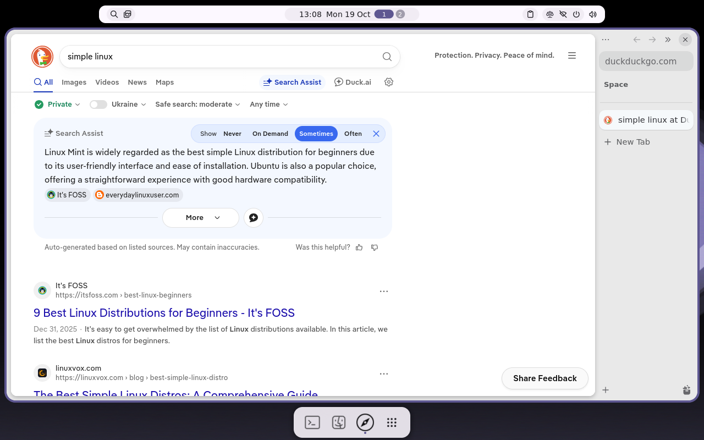</a></td>
  </tr>
  <tr>
    <td><b>Browser</b><br><sub>Zen Browser, ready to use, with DuckDuckGo.</sub></td>
  </tr>
</table>

## The installer

The graphical installer of the GUI image, page by page.

<table>
  <tr>
    <td width="50%"><a href="docs/img/0.2.33/01-welcome.png">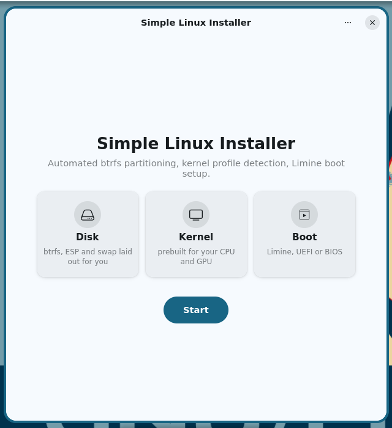</a></td>
    <td width="50%"><a href="docs/img/0.2.33/02-keyboard.png">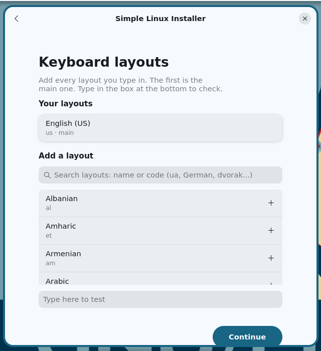</a></td>
  </tr>
  <tr>
    <td><b>Welcome</b><br><sub>The installer's first screen: disk, kernel and boot are decided for you.</sub></td>
    <td><b>Keyboard layouts</b><br><sub>Add every layout you type; the first is the main one, and a box lets you test them.</sub></td>
  </tr>
  <tr>
    <td width="50%"><a href="docs/img/0.2.33/03-timezone.png">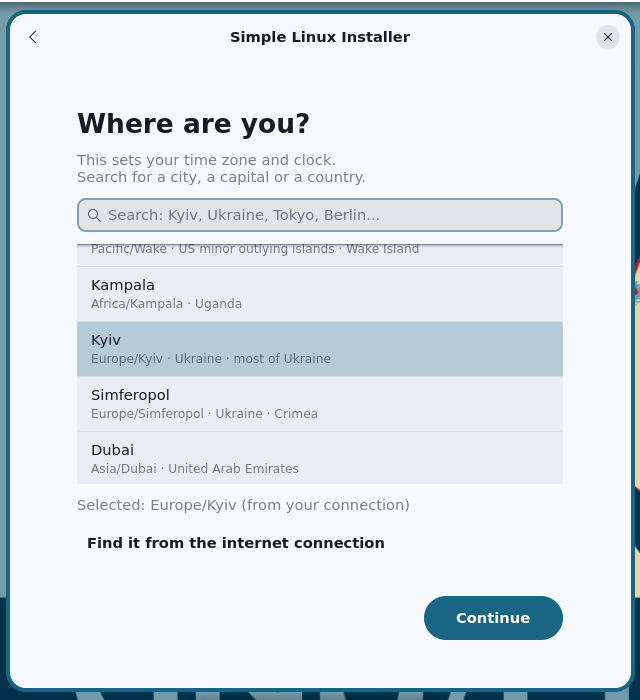</a></td>
    <td width="50%"><a href="docs/img/0.2.33/04-desktop.png">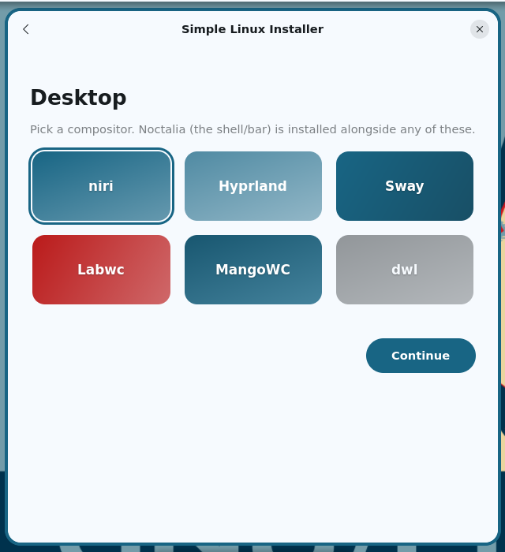</a></td>
  </tr>
  <tr>
    <td><b>Time zone</b><br><sub>Search for a city, capital or country, or let the internet connection tell.</sub></td>
    <td><b>Desktop</b><br><sub>Pick a compositor (niri, Hyprland, Sway, Labwc, MangoWC, dwl); Noctalia comes with any of them.</sub></td>
  </tr>
  <tr>
    <td width="50%"><a href="docs/img/0.2.33/05-graphics.png">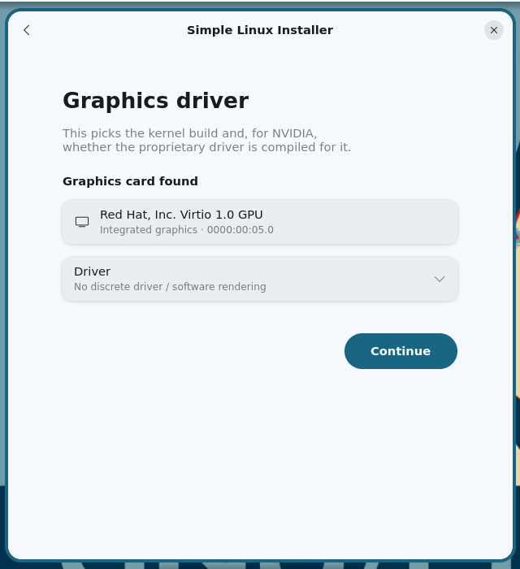</a></td>
    <td width="50%"><a href="docs/img/0.2.33/06-software.png">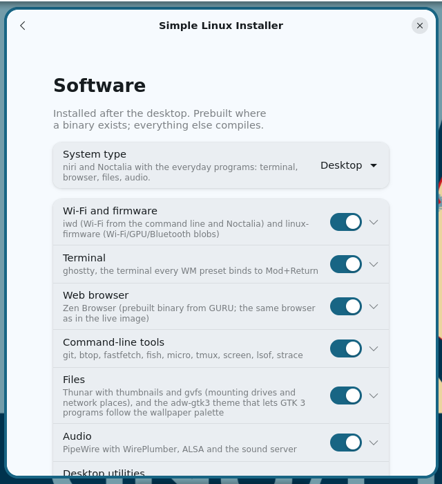</a></td>
  </tr>
  <tr>
    <td><b>Graphics driver</b><br><sub>The cards found; the choice picks the kernel build and, for NVIDIA, whether the proprietary driver is compiled.</sub></td>
    <td><b>Software</b><br><sub>A system type (console, desktop, workstation) and groups of programs to tick.</sub></td>
  </tr>
  <tr>
    <td width="50%"><a href="docs/img/0.2.33/07-software-expanded.png">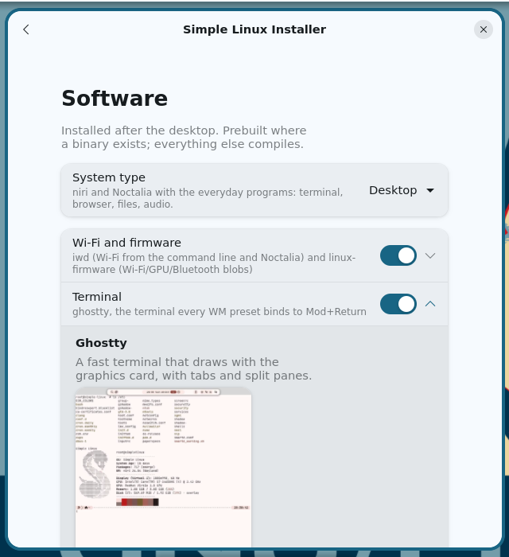</a></td>
    <td width="50%"><a href="docs/img/0.2.33/08-build-options.png">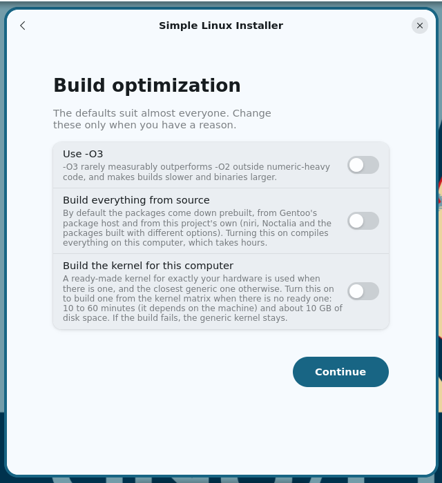</a></td>
  </tr>
  <tr>
    <td><b>A group opened</b><br><sub>Every program says in a sentence what it is, and many have a screenshot.</sub></td>
    <td><b>Build options</b><br><sub>-O3, building everything from source, building the kernel for this computer: all off by default.</sub></td>
  </tr>
  <tr>
    <td width="50%"><a href="docs/img/0.2.33/09-disk.png">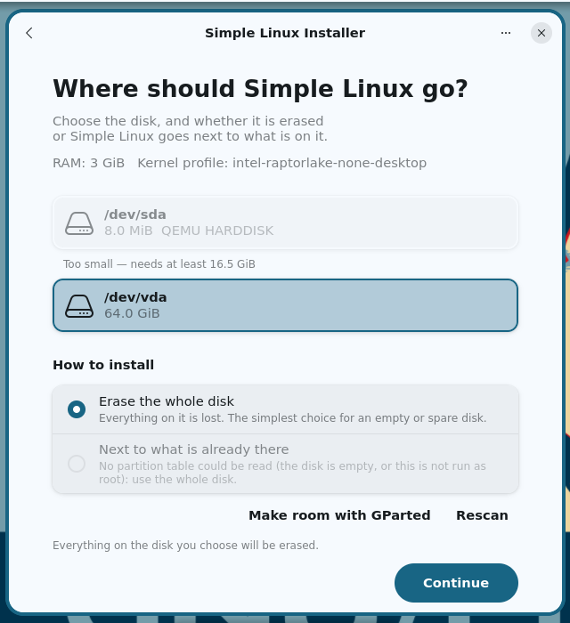</a></td>
    <td width="50%"><a href="docs/img/0.2.33/10-installing.png">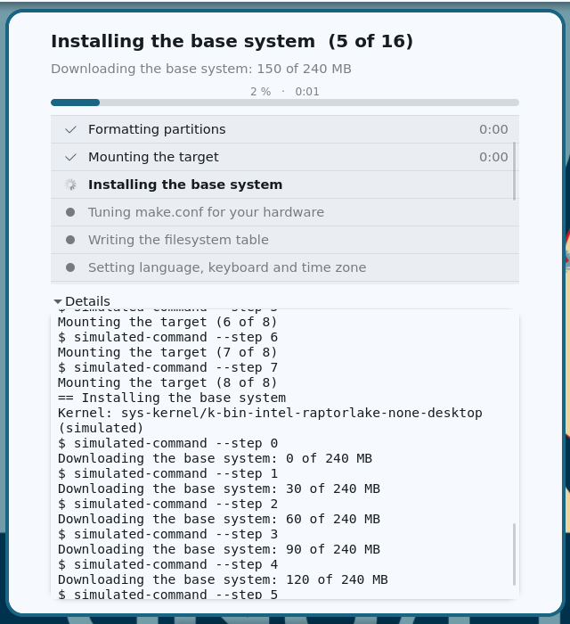</a></td>
  </tr>
  <tr>
    <td><b>Disk</b><br><sub>Erase the whole disk, or install next to what is already there; disks that are too small are greyed out.</sub></td>
    <td><b>Installing</b><br><sub>Sixteen phases with a progress bar and a live log (this is the simulated run).</sub></td>
  </tr>
  <tr>
    <td width="50%"><a href="docs/img/0.2.33/11-done.png">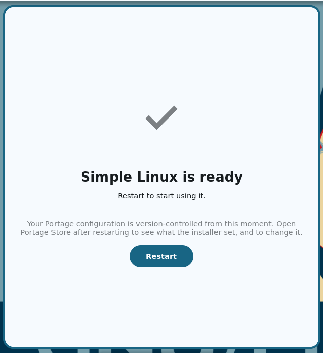</a></td>
  </tr>
  <tr>
    <td><b>Done</b><br><sub>Restart and the system is ready.</sub></td>
  </tr>
</table>

## Why this instead of a plain Gentoo install

Gentoo's handbook route is a day of typing and hours of compiling. Simple Linux keeps Gentoo underneath (Portage, OpenRC, your own `USE` flags
and overlays stay available) and removes the first day:

- **A real installer, with a graphical one.** Partitioning, locale and time zone (guessed from the keyboard layout), user, desktop, software groups
  and GPU driver are choices in a wizard; a failed install can be **resumed** from where it stopped instead of started over.
- **Flavors and software groups, like Funtoo's profiles.** Choose `minimal`, `desktop` or `workstation` and tick groups (office, media, development,
  gaming, Steam, Minecraft, the open-source Craft creative apps...) on a page that shows what each program is and, for many, a screenshot. The same choice
  is kept on the installed system and changed with the `slp` command. Details in [gentoo-installer](https://github.com/tarilka0gg/gentoo-installer).
- **A kernel built for your hardware, not compiled on it.** The installer detects CPU generation, GPU vendor and laptop/desktop, and copies the matching prebuilt kernel
  from the store (a generic x86-64 v2/v3 build when nothing more specific exists).
- **A binary install.** The packages come prebuilt: from Gentoo's own binhost, and from [this project's own](https://github.com/tarilka0gg/simple-linux-binhost)
  for what Gentoo does not build (niri, Noctalia, ghostty, the packages whose USE the installer changes), signed and built against the same Portage
  tree snapshot the installer unpacks. A full install, desktop and the software groups that existed at 0.2.31, merged 263 packages in a VM and compiled none (about 15 minutes); the Steam, Minecraft and Craft groups added later download their programs and Steam compiles 32-bit libraries.
- **A desktop that is ready.** niri + Noctalia whose colours follow the wallpaper (the terminal, GTK programs, btop, tmux, fastfetch and the niri
  borders too, through Noctalia's templates), PipeWire, Thunar, a browser that downloads itself, plus
  [ustan](https://github.com/tarilka0gg/ustan) for `.deb`, AppImage, Flatpak and `.exe` files and a graphical app store for Portage.
  Terminal programs behave like desktop apps: micro gets a folder badge that opens a file picker in the same window, and btop, micro and tmux have launcher entries with
  icons in the style of the rest (tui-shim). The launcher starts with the installer, the terminal, files and the browser on top.
- **Every decision is a `git log`.** The installer commits what it wrote to `/etc/portage`, so "what did it do" and "undo it" are ordinary git.
- **You can see and check it.** The images are signed (`SHA256SUMS.sig`), Secure Boot capable, and this repository is the configuration, not a blob.

What it is not: not a binary distribution with its own repository of everything (anything outside Gentoo's binhost and this project's compiles on your machine),
no disk encryption yet, no Microsoft-signed Secure Boot (an installed system can sign its own bootloader with a key made on that machine, see below), and still young: it **boots and installs on the author's real hardware**, but only a few machines have seen it (see below). If you want a distro that is
finished and supported today, use one; if you want Gentoo without the first day, try this and report what happens.

## Downloads

Everything large is attached to the **Releases** page (GitHub will not take files over 100 MB in git).
`SHA256SUMS` lists all of them.

| File | Size | What it is |
|---|---|---|
| `simple-linux-minimal.iso` | 0.34 GB | text installer (TUI), rescue tools, firmware |
| `simple-linux-gui.iso` | 0.48 GB | the same plus a niri + Noctalia desktop (floating bar, colours from the wallpaper), Zen (downloaded on first use), Thunar, GParted, Portage Store, tui-shim (file picker and launchers for terminal programs), PipeWire, with a graphical installer |
| `simple-linux-gui-offline.iso` | 1.6 GB | the GUI image **with everything an install downloads** (stage3, kernels, packages, Portage tree, configs): installs with no network. Default software groups and open-source GPU drivers; Zen, the optional groups and NVIDIA's driver need a network afterwards. `linux-firmware` is cut down on this image (full set: `emerge -1 sys-kernel/linux-firmware` online) |
| `simple-linux-minimal-offline.iso` | 1.4 GB | the same for the text installer |
| `simple-linux-stage3-amd64-openrc.tar.xz` | 173 MB | the stage3 the installer unpacks. The images no longer contain it: the installer downloads this file from the latest release (needs network, which the install needs anyway), and checks it against the `.sha512` next to it |
| `simple-linux-stage3-amd64-openrc.tar.xz.sha512` | 170 B | its SHA-512, read by the installer |
| `simple-linux-kernel-7.1.8.vmlinuz` | 13 MB | the live kernel |
| `simple-linux-kernel-7.1.8-modules.tar.xz` | 12 MB | its modules (`lib/modules/7.1.8-cachyos1`) |
| `simple-linux-kernel-store.tar` | 248 MB | the per-hardware kernel store the installer picks from: 10 builds (generic x86-64 v2/v3 and Raptor Lake, by GPU vendor and laptop/desktop) with their modules, plus the `Packages` index |
| `SHA256SUMS`, `SHA256SUMS.sig` | | checksums and their signature (see below) |

Both ISOs boot on BIOS and UEFI (Limine). Current version: **0.2.37** (what changed: [CHANGELOG.md](CHANGELOG.md)). Versions before 0.1.2 are withdrawn: they did not boot on the first laptop they were tried on.

### Verifying the download

The checksums are signed with an ssh key; its public half is in `signing/allowed_signers`. With the files, `SHA256SUMS` and `SHA256SUMS.sig` in one directory:

```
sh signing/verify.sh .
```

This checks the signature and then the files. The signing key (`SHA256:mvyK27nZZuGrO5vkK+yW+dVJSclojy3sPV1QZjZaZiw`) is the author's; if a release ever fails this check, do not use it.

### Secure Boot

Both ISOs are Secure Boot capable but **not Microsoft-signed**: a stock firmware refuses them ("Access Denied"). Either turn Secure Boot off, or enrol `secureboot/simple-linux-db.cer` in the firmware's `db` (setup menu → Secure Boot → Key Management). Limine is signed with that key and pins its config, the kernel and the initramfs by hash. Checked under OVMF: boots with the key enrolled, refused with Microsoft's keys. The *installed* system is not set up for Secure Boot.

## Try it

In a VM: `qemu-system-x86_64 -enable-kvm -m 4096 -cdrom simple-linux-minimal.iso` (add an OVMF pflash for UEFI).

On a stick (this erases the stick — check the device name first):

```
sha256sum -c --ignore-missing SHA256SUMS
sudo dd if=simple-linux-gui.iso of=/dev/sdX bs=4M status=progress conv=fsync
```

The live system logs in as `root` automatically (empty password) and starts the installer. The GUI image
starts a niri session with the installer window; **niri refuses software rendering**, so on a machine
without hardware-accelerated graphics the GUI image falls back to the text installer after ~25 seconds
(log: `/var/log/niri-session.log`). DHCP runs at boot; Wi-Fi is `iwd` (`iwctl`, the Noctalia network
widget, or the TUI's network screen).

## Booting from Ventoy

Copy the `.iso` onto a Ventoy stick and pick it; since 0.2.15 the default (*Boot in normal mode*) works on BIOS and on UEFI, and
*Boot in grub2 mode* works too (Ventoy then reads the image's `boot/grub/grub.cfg`, loads the kernel itself and makes the ISO visible
to the live system). On 0.2.14 and older, *normal mode* on BIOS stopped with "Could not determine boot drive": use grub2 mode with
those. Tested with Ventoy 1.1.17 in QEMU (BIOS and UEFI), and it boots from the author's Ventoy stick on real hardware. 0.2.0 and older had no `grub.cfg` and could not be
started from Ventoy at all.

## If it does not start on your machine

Limine shows a menu for 3 seconds (Ventoy's GRUB mode: 5). Try the entries in this order and note which one works:

1. **Simple Linux (live)** - the default, screen only, kernel and dracut messages visible.
2. **USB workaround** - for `usb X-Y: device descriptor read/64, error -71`, the classic enumeration failure
   (it helps most when the boot stick sits in the failing port; also try another port, USB 2 if you have one).
3. **safe graphics (nomodeset)** - if the screen goes black after the kernel starts; you get the text installer.
4. **verbose** - every kernel and initramfs message, and a shell if the live medium is not found.
5. **serial console** - only if you have a serial cable.

`[Firmware Bug]: TSC_DEADLINE disabled ... please update microcode` and `error -71` on some USB port are
warnings on their own; if boot stops, the lines *after* them (use entry 4) say why. Early versions had a
console setting that hid those lines on laptops with a phantom serial port; that is fixed and CPU
microcode now loads early. The images **boot and install on the author's real hardware**; other machines are untested, so reports of what the verbose
entry prints on a failing machine are the most useful thing you can send.

## What is in the images

- **Base**: Gentoo stage3 (OpenRC, 2026-09-27), kernel 7.1.8 (the CachyOS-patched tree, a generic config), dracut
  live boot with OverlayFS, `fish` as root's shell with `eza`/`dust`/`gping`/`micro` aliases, no `nano`.
- **Firmware and rescue kit**: `linux-firmware` (pruned to laptop/desktop hardware), `sof-firmware`,
  microcode; `xfsprogs`, `ntfs-3g`, `exfatprogs`, `f2fs-tools`, `cryptsetup`, `lvm2`, `mdadm`, `testdisk`,
  `ddrescue`, `smartmontools`, `nvme-cli`, `hdparm`, `usbutils`, `dmidecode`, `htop`, `tmux`, `screen`, `tcpdump`, `nmap`, `gptfdisk`, `iw`, `wpa_supplicant`, `Memtest86+`, ….
- **GUI image only**: niri 26.04, Noctalia 5.2.1, ustan (with its menu entry; the minimal image has the `ustan` command), Zen Browser (downloaded on first use), Thunar (gvfs, tumbler), GParted, PipeWire +
  WirePlumber, ghostty, `btop`, `imv`, `wl-clipboard`, `grim`, tui-shim.
- Package lists (`category/name-version`, from the image's package database): `packages/minimal.txt`,
  `packages/gui.txt`. They include packages that were needed to *build* the image; their compilers, headers
  and documentation were left out of the squashfs, so the list is longer than what is on disk.

## Files in this repository

| Path | |
|---|---|
| `profile/` | the desktop setup the GUI image boots into: niri config, Noctalia config and settings (bar, dock, theme), community palettes. Derived from the author's own setup with machine- and person-specific parts removed (start-up services and scripts, monitors, home address, wallpaper paths, history) |
| `kernel/config-7.1.8-cachyos1-live` | the full kernel `.config` of the shipped kernel |
| `kernel/kernel-live.fragment` | the options added on top of `x86_64_defconfig` |
| `packages/` | installed-package lists |
| `SHA256SUMS`, `SHA256SUMS.sig` | checksums of the release files and their signature |
| `signing/` | the public key (`allowed_signers`), `verify.sh`, and the maintainer's `sign.sh` |
| `secureboot/simple-linux-db.cer` | the certificate to enrol for Secure Boot |

## What has and has not been tested

Tested, in QEMU/KVM: all four images boot on BIOS and UEFI (as a CD, and the minimal one as a USB stick); the GUI image reaches the niri session with the installer, Thunar, Zen and PipeWire running on a
virtual 3D GPU; full headless installs from the minimal image onto a blank virtual disk (default and every software group of 0.2.31, all binary packages), after which the installed system boots on its own and
the created user logs in with fish, btrfs subvolumes and `/boot` mounted, `doas` installed; a console-only install interrupted at the base-system step and resumed to the end; and, for the offline
images, a full install of the GUI offline image with the outside network blocked. The generic kernels have no virtual-GPU driver, so a *picture* of the installed desktop was not seen in a VM.

Work for the next release (see the *Unreleased* section of [CHANGELOG.md](CHANGELOG.md): install next to other systems, several keyboard layouts, time zone search, an optional kernel built on the
machine) was checked in a VM only, headless.

**Real hardware:** boots and installs on the author's machine; nothing is known about others. Also not done or not confirmed: the desktop and GPU-driver steps on a real target (a compile of niri and Noctalia was not part of the test), the Wi-Fi screen against a real `iwd`, LUKS in the installer, Secure Boot for the installed system. Treat it as an early build, but a working one.

## License

See [NOTICE.md](NOTICE.md). The files in this repository (configuration and documentation) are
GPL-2.0-or-later, like the installer; the images contain many packages under their own licences.
